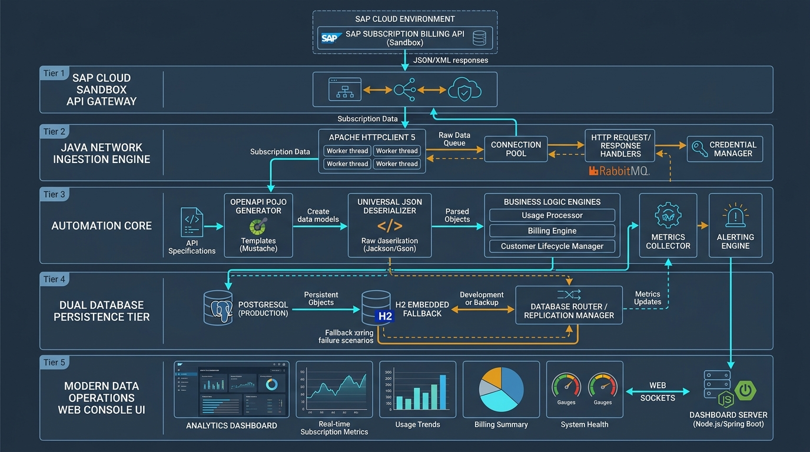
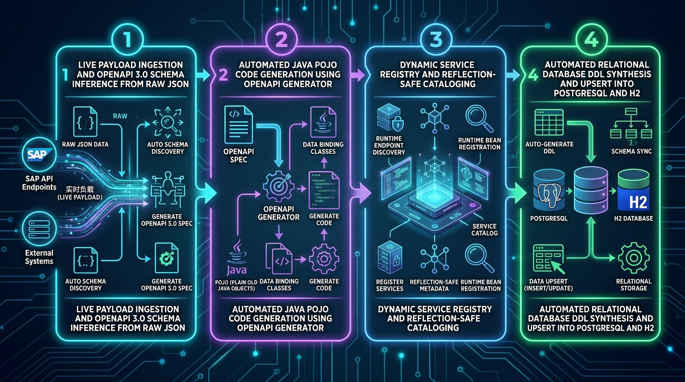
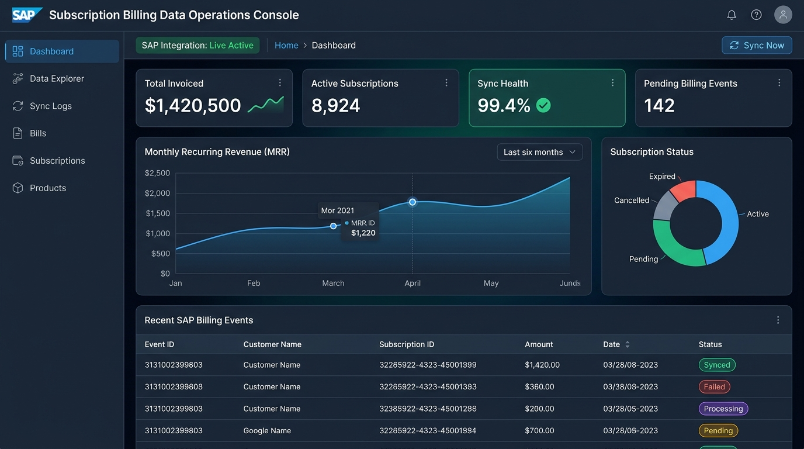

# SAP Subscription Billing — Crawler, Auto-POJO & Analytics Engine

<p align="center">
  
</p>

<p align="center">
  
  
  
  
  
  
</p>

---

## 📑 Table of Contents
1. [Executive Summary & Motivation](#1-executive-summary--motivation)
2. [Key Innovations & Features](#2-key-innovations--features)
3. [End-to-End System Architecture](#3-end-to-end-system-architecture)
4. [The 4-Stage Automated Pipeline Lifecycle](#4-the-4-stage-automated-pipeline-lifecycle)
5. [Enterprise Data Operations Console UI](#5-enterprise-data-operations-console-ui)
6. [Database Strategy: Dual-Engine Hybrid Persistence](#6-database-strategy-dual-engine-hybrid-persistence)
7. [REST API Specification Reference](#7-rest-api-specification-reference)
8. [Directory Structure](#8-directory-structure)
9. [Getting Started & Quick Start](#9-getting-started--quick-start)
10. [Step-by-Step: Adding Any New SAP Service](#10-step-by-step-adding-any-new-sap-service)
11. [Testing, Security & Quality Assurance](#11-testing-security--quality-assurance)
12. [Recent Engineering Updates](#12-recent-engineering-updates)

---

## 1. Executive Summary & Motivation

Enterprise ERP ecosystems like **SAP Subscription Billing** manage mission-critical monetization cycles: recurring bills, multi-tier subscription agreements, rate plans, allowances, customer master records, and high-frequency usage telemetry. 

Integrating and synchronizing these microservices into downstream analytics databases traditionally imposes significant engineering bottlenecks:
* **Payload Wrapper Inconsistencies:** SAP responses vary arbitrarily across endpoints (`bills`, `subscriptions`, `items`, `value`, `data`, or OData `d.results`).
* **Manual DTO / POJO Maintenance:** Authoring strongly-typed Java POJOs with dozens of nested sub-objects is error-prone, fragile, and breaks when upstream schemas evolve.
* **Database Migration Overhead:** Engineering teams must manually construct SQL DDL schemas, map types, manage schema versioning, and implement atomic upsert operations.

### The Solution: 1-Click Zero-Boilerplate Automation
This project implements a complete, self-healing **1-Click Automation Architecture**:
1. **Dynamic Schema Inference:** Fetches live JSON from any SAP endpoint and automatically reverse-engineers a strict, compliant OpenAPI 3.0 specification.
2. **Programmatic POJO Generation:** Triggers OpenAPI Generator programmatically to produce typed, annotated Java models with Jackson bindings.
3. **Universal Deserialization:** Dynamically detects and unwraps any nesting pattern without bespoke deserializers.
4. **Dynamic Database Table Synthesis:** Generates relational DDL tables on the fly in **PostgreSQL** (with zero-config **H2 Embedded** fallback) while preserving full document fidelity via `raw_json TEXT`.
5. **Real-Time Data Operations Console:** An editorial, dark-and-accent web dashboard featuring Chart.js analytics, recursive JSON detail drawers, multi-service exploration, and live sync controls.

---

## 2. Key Innovations & Features

- **🚀 1-Click Service Onboarding:** Feed any arbitrary SAP Subscription Billing endpoint into `auto_service_setup.bat`. Within seconds, the system discovers fields, synthesizes an OpenAPI spec, generates Java code, creates relational database tables, and syncs live records.
- **🔄 Universal Wrapper Unwrapping:** `GenericSapParser.java` intelligently traverses and unwraps root arrays, wrapped arrays (`bills`, `subscriptions`, `items`, `data`, `value`), and OData wrappers (`d.results`).
- **🛡️ Resilient Dual-Engine Persistence:** Automatic detection of local PostgreSQL (`localhost:5432/sap_bills`). If PostgreSQL is unreachable, the engine seamlessly switches to an embedded H2 database (`./data/sap_bills_db`) without human intervention or data loss.
- **📊 Enterprise Data Operations Console:** Modern single-page application (SPA) featuring:
  - Metric summary KPI cards (Total Invoiced, Active Subscriptions, Sync Health, Pending Events).
  - Monthly Recurring Revenue (MRR) line charts and subscription status donut charts.
  - Multi-Service Data Explorer with real-time text search, status filters, and multi-field sorting.
  - Deep Detail Drawer with recursive nested object cards, sub-tables, and JSON inspection.
  - Add Service Modal with verified SAP API Business Hub Sandbox endpoint presets.
- **🔒 Enterprise Security & Code Quality:**
  - Path-traversal sanitization (CWE-22) in static file serving.
  - Parameterized PreparedStatements and strict alphanumeric identifier validation against SQL Injection (CWE-89).
  - SLF4J structured logging throughout, replacing console dumps.
  - Externalized credentials and API keys via `.env` files.

---

## 3. End-to-End System Architecture

<p align="center">
  
</p>

The system is organized into five decoupled, cohesive architectural tiers:

| Tier | Component | Key Technologies | Description |
|---|---|---|---|
| **Tier 1** | **SAP Cloud Sandbox** | HTTPS / TLS 1.3 / APIKey | SAP API Business Hub Sandbox serving live Subscription Billing microservices. |
| **Tier 2** | **Network Ingestion Engine** | Apache HttpClient 5 | Connection pooling, socket/connect timeouts (10s/15s), and header injection (`SapApiClient.java`). |
| **Tier 3** | **Automation Core** | Jackson Databind, OpenAPI Generator | Dynamic schema inferencer, code generator, and universal JSON deserializer (`SapAutoServiceManager.java`, `GenericSapParser.java`). |
| **Tier 4** | **Dual Database Persistence** | PostgreSQL & H2 Database | Dynamic DDL generation, ANSI SQL upserts, and automatic connection routing (`DatabaseManager.java`). |
| **Tier 5** | **Presentation & REST Server** | Java Built-in HTTP Server, Chart.js, HTML5/CSS3/ES6 | Low-overhead multi-threaded REST API server (`BillServer.java`) and rich Data Operations Console (`frontend/`). |

---

## 4. The 4-Stage Automated Pipeline Lifecycle

<p align="center">
  
</p>

When executing `auto_service_setup.bat <serviceName> <serviceUrl>`, the engine runs through four automated stages:

### Stage 1: Live Payload Ingestion & Schema Inference
- Queries the live endpoint using `SapApiClient`.
- Analyzes the JSON structure: identifies fields, primitive types, dates, nested objects, and arrays.
- Generates a fully-compliant OpenAPI 3.0 specification file saved under `specs/<service>-spec.json`.

### Stage 2: Strong-Typed POJO Generation
- Executes `openapi-generator-maven-plugin` programmatically.
- Produces production-ready Java models equipped with Jackson annotations (`@JsonProperty`), getters, setters, and `toString()` under `src/main/java/projectsap/sap/<service>/model/`.

### Stage 3: Dynamic Service Registry
- Dynamically catalogs the service in `SapServiceRegistry.java`.
- Resolves class references via `Class.forName()`, decoupling compile-time dependencies and allowing hot service registration without breaking build paths.

### Stage 4: Automated Relational Table DDL & Upsert
- Checks database catalogs for table existence.
- Dynamically constructs and executes `CREATE TABLE IF NOT EXISTS <service>s` with mapped typed columns and a `raw_json TEXT` column.
- Performs idempotent ANSI SQL upserts to persist records with full data fidelity.

---

## 5. Enterprise Data Operations Console UI

<p align="center">
  
</p>

The frontend console is built with zero heavy frameworks, utilizing modern native web technologies (HTML5, Vanilla CSS3, ES6+ JavaScript, Chart.js):

- **Executive KPI Cards:** Instant metrics on total billed revenue, active customer subscriptions, sync health score, and pending billing events.
- **Data Visualizations:** Dynamic Chart.js visualizations for revenue trajectories, subscription lifecycle distributions, and currency breakdowns.
- **Service Dashboards & Data Explorer:** Dedicated tabs for registered services (Bills, Subscriptions, Products, Forecasts, Rate Plans, Usage Records, Allowances) with instant search, status pills, and sorting.
- **Deep Recursive Detail Drawer:** Clicking any row opens an inspect panel rendering nested objects as sub-cards, nested arrays as mini-tables, and providing one-click JSON copying.
- **Live Sync Controls & Modal:** Trigger single-service or global synchronization with real-time sync status badges.

---

## 6. Database Strategy: Dual-Engine Hybrid Persistence

```
                        +------------------------------------+
                        |  DatabaseManager.getConnection()   |
                        +------------------------------------+
                                          |
                              [Attempt PostgreSQL: 5432]
                                          |
                         +----------------+----------------+
                         |                                 |
                   [Connected]                        [Unreachable]
                         v                                 v
          +-----------------------------+   +-----------------------------+
          |   PostgreSQL Engine         |   |   H2 Embedded Fallback      |
          |   Host: localhost:5432      |   |   Path: ./data/sap_bills_db |
          |   DB:   sap_bills           |   |   Mode: PostgreSQL Dialect  |
          |   Production Relational DB  |   |   Zero External Dependency  |
          +-----------------------------+   +-----------------------------+
```

### Table Schemas:
1. **`bills`**: Primary invoice and billing items extracted from SAP.
2. **`subscriptions`**: Subscription agreements, customer mappings, renewal dates, and lifecycle states.
3. **`fetch_log`**: Comprehensive audit trail capturing sync timestamps, target services, record counts, and status.
4. **`<dynamic_service>s`**: Inferred relational tables (`products`, `forecasts`, `rate_plans`, etc.) synthesized on demand.

All tables preserve full raw payloads in a `raw_json TEXT` column to guarantee 100% backward compatibility when upstream fields are added.

---

## 7. REST API Specification Reference

The built-in HTTP server (`BillServer.java`) hosts REST endpoints on port **8080** (with automatic fallback to **8085** if 8080 is in use):

| Method | Endpoint | Parameters | Description |
|---|---|---|---|
| `GET` | `/api/bills` | `status`, `type`, `currency` | Retrieves stored billing records with optional query filtering |
| `GET` | `/api/bills/{id}` | `id` (Path) | Retrieves single detailed bill record by identifier |
| `GET` | `/api/stats` | None | Aggregated financial metrics, currency breakdowns, and status counts |
| `GET / POST` | `/api/sync` | `service` (Query) | Triggers on-demand ingestion for bills or specified service |
| `GET / POST` | `/api/sync/{service}` | `service` (Path) | Ingests data from the specified service endpoint and persists to DB |
| `GET` | `/api/data/{service}` | `service` (Path) | Returns stored database records for any dynamically registered service |
| `GET` | `/api/services` | None | Lists all active services, mapped tables, and current record counts |
| `GET` | `/api/fetch-log` | None | Returns the synchronization history and audit log |

---

## 8. Directory Structure

```
sap_crawler_final/
├── docs/
│   └── images/                       # Generated architecture & dashboard graphics
│       ├── banner_hero.jpg
│       ├── architecture_diagram.jpg
│       ├── dashboard_console.jpg
│       └── pipeline_workflow.jpg
├── frontend/                         # Enterprise Data Operations Console
│   ├── index.html                    # Single-Page Application structure & modals
│   ├── styles.css                    # IBM Carbon & Glassmorphic design tokens
│   └── app.js                        # State management, Chart.js rendering, Drawer logic
├── specs/                            # Inferred & Generated OpenAPI 3.0 Specifications
│   ├── allowances-spec.json
│   ├── forecast-spec.json
│   ├── product-spec.json
│   ├── rate_plan-spec.json
│   ├── subscription-spec.json
│   └── usagerecords-spec.json
├── src/
│   ├── main/java/projectsap/sap/
│   │   ├── bill/model/               # Generated Bill POJOs
│   │   ├── common/                   # Universal Parser, Registry, AutoServiceManager
│   │   │   ├── GenericSapParser.java
│   │   │   ├── SapAutoServiceManager.java
│   │   │   └── SapServiceRegistry.java
│   │   ├── core/
│   │   │   ├── client/SapApiClient.java       # Resilient HTTP Client (Apache 5)
│   │   │   ├── db/DatabaseManager.java        # Dual-Engine Persistence & DDL
│   │   │   ├── db/DatabaseViewer.java         # CLI DB Inspection Utility
│   │   │   └── server/BillServer.java         # Multi-Threaded REST API Server
│   │   ├── product/model/            # Generated Product POJOs
│   │   ├── subscription/model/       # Generated Subscription POJOs
│   │   └── Main.java                 # Core Application Entrypoint
│   └── test/java/projectsap/sap/     # Unit & Integration Test Suites
├── auto_service_setup.bat            # 1-Click Service Automation Script (Windows)
├── auto_service_setup.ps1            # 1-Click Service Automation Script (PowerShell)
├── generate_service_pojos.bat        # Batch POJO generator from OpenAPI specs
├── run.bat                           # Launch Web Console & REST Server (port check)
├── test.bat                          # Run comprehensive test suite
├── view_db_data.bat                  # Terminal database viewer
├── pom.xml                           # Maven dependencies & build configurations
└── .env.example                      # Environment configuration template
```

---

## 9. Getting Started & Quick Start

### Prerequisites
* **Java Development Kit (JDK):** Version 17 or higher
* **Apache Maven:** Version 3.8+
* **PostgreSQL (Optional):** Version 13+ (H2 Embedded will activate automatically if PostgreSQL is absent)

### Step 1: Clone Repository
```bash
git clone https://github.com/Shrawan-51/sap_crawler_final.git
cd sap_crawler_final
```

### Step 2: Environment Configuration
Create a `.env` file in the project root (or copy `.env.example`):
```ini
SAP_API_KEY=your_sap_api_key_here
DB_HOST=localhost
DB_PORT=5432
DB_NAME=sap_bills
DB_USER=postgres
DB_PASSWORD=your_password
```
*(Note: If PostgreSQL is not running, the application will automatically launch and persist to the embedded H2 database located at `./data/sap_bills_db`.)*

### Step 3: Run the Application
Start the application server using the automated batch runner:
```powershell
.\run.bat
```
The server will start on `http://localhost:8080` (or `http://localhost:8085` if port 8080 is occupied). Open your browser to explore the **Data Operations Console**.

---

## 10. Step-by-Step: Adding Any New SAP Service

To ingest and automate any new SAP Subscription Billing microservice, execute a single command:

```powershell
.\auto_service_setup.bat <service_name> "<sap_endpoint_url_or_spec>"
```

### Example: Onboarding SAP "Product" Service
```powershell
.\auto_service_setup.bat product "https://sandbox.api.sap.com/subscriptionbilling/api/product/v1/products"
```

### What Happens Automatically:
1. **Network Ingestion:** `SapApiClient` fetches live sample payloads from SAP Sandbox.
2. **OpenAPI Synthesis:** `SapAutoServiceManager` generates `specs/product-spec.json`.
3. **POJO Synthesis:** OpenAPI Generator creates strongly-typed models under `src/main/java/projectsap/sap/product/model/`.
4. **Dynamic Registration:** Service is registered in `SapServiceRegistry`.
5. **Database Table Creation:** `DatabaseManager` executes dynamic DDL:
   ```sql
   CREATE TABLE IF NOT EXISTS products (
       id VARCHAR(255) PRIMARY KEY,
       code VARCHAR(255),
       name VARCHAR(255),
       description TEXT,
       pricing_scheme_id VARCHAR(255),
       raw_json TEXT,
       fetched_at TIMESTAMP DEFAULT CURRENT_TIMESTAMP,
       updated_at TIMESTAMP DEFAULT CURRENT_TIMESTAMP
   );
   ```
6. **Data Upsert:** Live products are ingested immediately into the database.
7. **Instant Access:** Accessible via REST API (`/api/data/product`) and within the Web Console!

---

## 11. Testing, Security & Quality Assurance

### Running Tests
Execute the automated test suite:
```powershell
.\test.bat
```
Or test specific POJO conversions:
```powershell
.\test_auto_pojo.bat
.\test_subscription_pojo.bat
```

### Security & Hardening Controls (OWASP Standards)
* **Path Traversal Protection (CWE-22):** Canonical path verification in `BillServer.serveFile()` prevents directory escape via `../`.
* **SQL Injection Prevention (CWE-89):** Sanitized table identifiers via regex `^[a-zA-Z0-9_]+$` and parameterized statements for all queries.
* **Secret Isolation (CWE-798):** Sensitive tokens and database passwords are sequestered into `.env` and excluded from source control.
* **Deterministic Resource Management:** All JDBC connections and HTTP sockets leverage `try-with-resources` to eliminate connection leaks.
* **Structured Logging:** Production-ready SLF4J logging (`LoggerFactory.getLogger`) replacing legacy console prints.

---

## 12. Recent Engineering Updates

- **Fix (Build):** Resolved class naming casing alignment in `ProductMetaData.java`.
- **Feature (Verified Routes):** Updated SAP Sandbox endpoint preset chips with verified, active API routes.
- **Design Transformation:** Upgraded frontend to modern editorial branding with responsive grid layouts, IBM Carbon palette, and high-contrast typography.
- **Enhanced Detail Drawer:** Implemented recursive JSON rendering with nested object cards, sub-tables for object arrays, and one-click JSON clipboard export.
- **Auto Port Failover:** Enhanced `run.bat` to detect port 8080 conflicts and route to port 8085 automatically.

---

## 📄 License
This project is licensed under the MIT License - see the LICENSE file for details.